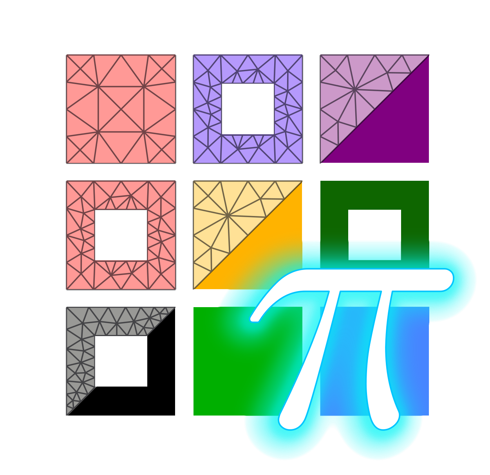

## Petra-M

Petra-M is a FEM analysis GUI built on the top of PyMFEM and piScope. It was born
originally as Physics Equation Translator for MFEM, to help assemble an FEM linear
system without writing C++ nor Python codes. The current version includes intefaces
to geometry building (via python-occ), mesh generation (via gmsh), and various FEM
analysis, such as stationaly, time-domain, and parametric analysis.

Petra-M includes
 - Weakform module to define PDE using various MFEM integrators.
 - Distance module to define PDE for measuring distance
 - Interface for various FEM analysis solvers.
 - Parametric geometry editor.
 - Procedural mesh generation.


### Install

The default installation is pure Python:

```shell
  pip install petram
```

#### Optional SuperLU_DIST backend

To build the optional parallel direct solver locally:

```shell
  python -m pip install --no-cache-dir --no-binary=petram -Cwith-superlu_dist=Yes petram
```

This downloads and builds SuperLU_DIST, OpenBLAS, METIS, and GKlib, applying 
the bundled patches to SuperLU_DIST. These native solver libraries are not bundled 
in the PyPI release. Third-party license notices are included in `LICENSES/`.
A C/C++ build toolchain, Git, and MPI compiler are required. MPI must be compatible 
with the runtime used by mpi4py and parallel PyMFEM.

### Licence
Petra-M project is released under the GPL v3 license.
See files COPYRIGHT and LICENSE file for full details.

### Optional dependency
 - gmsh  (4.10.5)  https://pypi.org/project/gmsh/
 - python-occ (7.9.0) https://github.com/tpaviot/pythonocc-core

### Reference
  S. Shiraiwa, et al. EPJ Web of Conferences 157, 03048 (2017)
